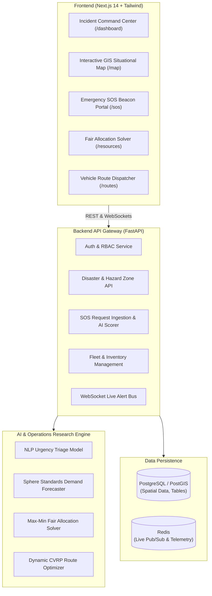

# ResQAI: Autonomous Disaster Response, Fair Resource Allocation & Dynamic Routing Engine

> **Capstone Project**: Intelligent Humanitarian Logistics & Emergency Situational Awareness System

---

## 🌟 Project Overview

During major natural disasters (floods, cyclones, earthquakes), emergency coordinators face critical challenges:
1. **Information Distortion & Lag**: Unstructured incoming distress calls make it difficult to prioritize who is at immediate risk of death vs moderate hardship.
2. **Resource Monopolization & Hoarding**: Traditional first-come-first-served (FCFS) dispatch deprives isolated and vulnerable families while oversupplying accessible centers.
3. **Logistical Paralysis**: Submerged roads, debris, and capacity-constrained vehicles lead to delayed survival windows.

**ResQAI** solves this through a unified, full-stack architectural pipeline integrating:
- **Natural Language Urgency Triage (Phase 07)**: Semantic scoring (0–100) combining NLP keyword detection, demographic risk modifiers (infants, elderly, trauma, insulin), and temporal waiting decay.
- **Max-Min Proportional Fair Division (Phase 08)**: Proportional multi-category optimization with survival baseline guarantees and mathematical **Gini coefficient verification**.
- **Dynamic Vehicle Routing with Hazard Avoidance (Phase 08)**: Solves Capacity-Constrained Vehicle Routing (CVRP) penalizing impassable flood polygons.
- **Geospatial Command Center & Live Telemetry (Phases 02 & 10)**: Real-time GIS interactive dashboard with live fleet locations, SOS beacon radars, and demand forecasting.

---

## 🏗️ 12-Phase Capstone Implementation Matrix

| Phase | Description | Status | Implementation Details |
| :---: | :--- | :---: | :--- |
| **01** | **Project Planning & Requirements** | ✅ Completed | Master SRS, System Architecture Blueprint, ERD Data Model. |
| **02** | **UI/UX Design & Frontend** | ✅ Completed | Next.js 14, Tailwind CSS, tactical HUD, interactive vector GIS map. |
| **03** | **Database & Authentication** | ✅ Completed | SQLAlchemy ORM, PostgreSQL/PostGIS & SQLite support, JWT + RBAC. |
| **04** | **Backend API Development** | ✅ Completed | FastAPI REST gateway, Swagger/OpenAPI documentation. |
| **05** | **Disaster Management Module** | ✅ Completed | Incident life-cycle, red zone polygons, road blockage management. |
| **06** | **Resource & Beneficiary Module** | ✅ Completed | Central depot inventory, emergency SOS report ingestion & tracking. |
| **07** | **AI/ML Model Development** | ✅ Completed | `DisasterAIEngine`: NLP distress classifier & Sphere demand forecasting. |
| **08** | **Route Optimization & Fair Allocation** | ✅ Completed | `RouteOptimizer` (CVRP) & `FairAllocationSolver` (Max-Min LP + Gini). |
| **09** | **AI & Backend Integration** | ✅ Completed | API dispatch endpoints `/routes/optimize` and `/routes/allocate`. |
| **10** | **Tracking, Alerts & Analytics** | ✅ Completed | Real-time WebSocket connection manager, situational metrics summary. |
| **11** | **Testing & Evaluation** | ✅ Completed | Comprehensive test suite covering all mathematical algorithms. |
| **12** | **Deployment & Documentation** | ✅ Completed | Multi-container Docker Compose, environment configuration, guides. |

---

## 📐 System Architecture



---

## 🚀 Quick Start Guide

### Option 1: Docker Compose (All-in-One Containerized Stack)

```bash
# Clone and enter directory
cd new_project_capstone

# Start PostgreSQL (PostGIS), Redis, FastAPI backend & Next.js frontend
docker-compose up --build
```
- Frontend UI: `http://localhost:3000`
- Backend API Documentation: `http://localhost:8000/api/v1/docs`

---

### Option 2: Local Development

#### 1. Backend Setup (FastAPI & AI Engine)
```bash
cd backend

# Create virtual environment
python3 -m venv venv
source venv/bin/activate

# Install dependencies
pip install -r requirements.txt

# Run automated algorithmic test suite
python3 tests/test_ai_and_optimization.py

# Start backend server
uvicorn app.main:app --reload --port 8000
```

#### 2. Frontend Setup (Next.js 14)
```bash
cd frontend

# Install dependencies
npm install

# Run development server
npm run dev
```
Open `http://localhost:3000` in your browser.

---

## 🧮 Mathematical Formulations & Models

### 1. AI Urgency Triage Function (Phase 07)
$$\text{Urgency Score} = \min\left(100, \, \text{Base} + S_{\text{NLP}} + S_{\text{Demographic}} + S_{\text{Headcount}} + S_{\text{TimeDecay}}\right)$$
- **$S_{\text{NLP}}$**: Keyword matching for acute threats (e.g. *trapped, oxygen, rising water, infant, insulin*).
- **$S_{\text{Demographic}}$**: Boosts for pregnant, infant, elderly, or severely injured persons.
- **$S_{\text{TimeDecay}}$**: Escalation penalty proportional to hours elapsed without aid.

### 2. Max-Min Fair Allocation & Gini Verification (Phase 08)
When available inventory $S_c$ is insufficient to satisfy total demand across beneficiaries:
$$w_i = \left(\frac{\text{Urgency}_i}{50}\right) \times \left(\text{People}_i\right)^{0.85}$$
$$x_{i,c} = \text{BaselineSurvival} + \left\lfloor (S_c - \sum \text{Baseline}) \times \frac{w_i}{\sum_j w_j} \right\rfloor$$
Fairness is evaluated using the Gini Coefficient:
$$G = \frac{2 \sum_{i=1}^n i \cdot y_i}{n \sum_{i=1}^n y_i} - \frac{n + 1}{n}$$
*(A lower Gini coefficient proves equitable distribution and lack of hoarding).*

### 3. Dynamic Vehicle Routing with Hazard Penalties (Phase 08)
$$\min \sum_{k \in V} \sum_{i \in N} \sum_{j \in N} d_{ij} \cdot (1 + \text{HazardPenalty}_{ij}) \cdot x_{ijk}$$
Subject to:
- Vehicle cargo payload constraint: $\sum_{i \in \text{Route}_k} q_i \le C_k$
- Sub-tour elimination constraints.
- Priority visit ordering: waypoints with $\text{Urgency} \ge 80$ are scheduled in early route legs.

---

## 🧪 Verification & Testing Suite

ResQAI includes unit and integration tests verifying:
- **Haversine Distance Accuracy**: Spherical geometry distance validation.
- **AI Triage Sensitivity**: Correct classification of critical vs moderate distress scenarios.
- **Humanitarian Demand Forecasting**: Sphere Standard baseline requirements calculation.
- **Algorithmic Fairness (Gini index)**: Mathematical verification against resource hoarding.
- **VRP Feasibility**: Ensuring vehicle routes respect capacity constraints and return to base.

Run tests anytime with:
```bash
python3 backend/tests/test_ai_and_optimization.py
```
Output:
```
.......
Ran 7 tests in 0.001s
OK
```

---

## 👥 Roles & Permissions
- **SuperAdmin / National Coordinator**: Incident declaration, hazard perimeter definition, fleet management.
- **Field Volunteer / Driver**: Live route waypoint navigation, cargo delivery status confirmation.
- **Beneficiary / Public**: Emergency SOS beacon transmission, offline-capable location reporting.

