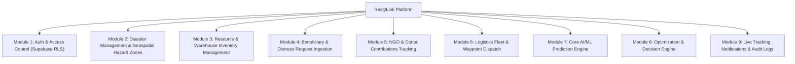
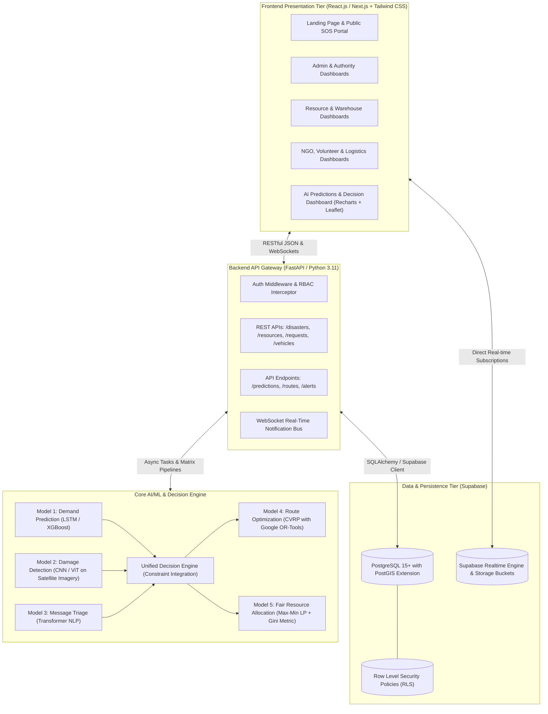
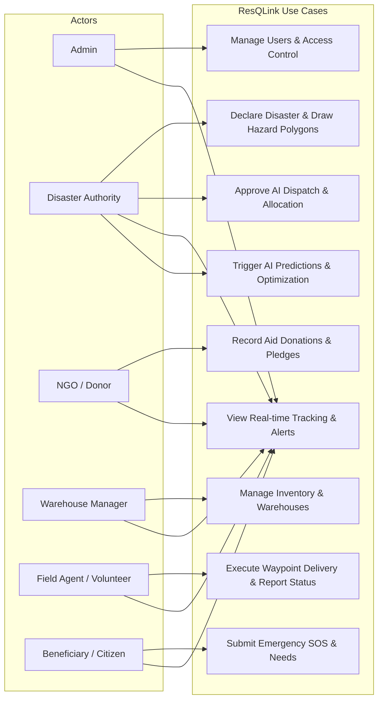

# Phase 1: Project Planning & Requirements Specification (SRS)
## Project Name: ResQLink — AI-Powered Disaster Management, Fair Resource Allocation & Route Optimization Platform

---

## 1. Final Problem Statement

Natural hazards—such as cyclones, flash floods, earthquakes, and landslides—lead to catastrophic disruption of civil infrastructure, acute loss of life, and logistical paralysis. Post-disaster humanitarian operations consistently encounter four systemic failures:

1. **Information Asymmetry & Distress Noise:** Emergency helplines and field networks are flooded with thousands of unstructured reports. First responders struggle to distinguish life-threatening medical emergencies (e.g., trapped infants, oxygen dependency, trauma) from non-critical supply requests.
2. **Resource Monopolization & Hoarding:** Without algorithmic fairness, relief supplies are dispersed on a first-come, first-served (FCFS) basis. Accessible roadside shelters exhaust inventories, while isolated and remote peripheral clusters suffer starvation and preventable casualties.
3. **Impassable Road Networks & Logistical Delays:** Submerged bridges, road debris, and hazardous flood basins turn standard navigation apps (Google Maps) ineffective. Dispatching generic vehicles down impassable routes results in stranded fleets and missed golden-hour survival windows.
4. **Siloed Coordination & Lack of Transparency:** Disaster authorities, NGOs, donors, warehouse managers, and field volunteers operate on fragmented spreadsheets, messaging groups, or proprietary tools without an immutable audit trail or live visibility.

### The ResQLink Solution
**ResQLink** is a centralized, AI-driven disaster management ecosystem that unites **Natural Language Emergency Triage**, **Satellite/Aerial Damage Detection**, **Predictive Resource Demand Forecasting**, **Max-Min Fair Resource Allocation**, and **Hazard-Aware Vehicle Route Optimization (CVRP)** into role-specific responsive web dashboards powered by **FastAPI**, **Supabase (PostgreSQL with RLS)**, and **React/Next.js**.

---

## 2. User Roles & Responsibilities Matrix

ResQLink enforces strict Role-Based Access Control (RBAC) across six distinct user classes:

| User Role | Key Responsibilities | Permitted Modules & Actions |
| :--- | :--- | :--- |
| **1. Admin** | System administration, platform health, user provisioning, global RBAC permissions, and auditing. | Full read/write access to all tables, user role assignments, audit log review, platform settings. |
| **2. Disaster Management Authority** | Incident declaration, monitoring disaster perimeter, impact zone declaration, authorizing AI-recommended dispatch plans. | Disaster Dashboard, Hazard Polygon mapping, severity updates, high-priority emergency broadcasts, AI decision approval. |
| **3. NGO / Donor** | Aid pledges, financial and resource donations, transparency verification, tracking distribution impact. | NGO Dashboard, donation logging, allocation audit tracking, resource impact metrics. |
| **4. Warehouse Manager** | Supply inventory tracking, recording inbound donations, packaging relief kits, dispatch staging, warehouse capacity. | Resource Dashboard, warehouse stock levels, low-stock threshold alerts, kit dispatch logs. |
| **5. Field Agent / Volunteer** | Last-mile delivery execution, ground truth damage confirmation, offline reporting, victim verification. | Volunteer Dashboard, assigned vehicle routes, turn-by-turn stop confirmation, ground damage photo uploads. |
| **6. Beneficiary (Public / Affected People)** | Submitting SOS emergency beacons, tracking aid delivery status, receiving localized evacuation warnings. | Landing Page SOS Portal, Beneficiary Dashboard, request status tracker, broadcast alert inbox. |

---

## 3. Application Modules Breakdown

1. **Authentication & RBAC Module:** Supabase Auth integration, JWT handling, Row Level Security policies per user role.
2. **Disaster Management Module:** Register disaster incidents, specify hazard categories (Flood, Cyclone, Earthquake), map affected district polygons, update disaster lifecycle (`ALERT` $\rightarrow$ `ACTIVE` $\rightarrow$ `RECOVERY` $\rightarrow$ `CLOSED`).
3. **Resource & Warehouse Management Module:** Multi-warehouse inventory catalog (Drinking water, food rations, medical kits, tents), threshold triggers, stock tracking.
4. **Beneficiary & SOS Intake Module:** Multi-lingual, mobile-first emergency beacon submission, headcount, vulnerability checklists (infants, elderly, injured), live status tracking.
5. **NGO & Donor Module:** Transparent financial & material pledge logging, automated receipts, supply fulfillment traceability.
6. **Logistics & Fleet Dispatch Module:** Fleet vehicle registry (Trucks, 4x4s, Boats, Drones), driver assignment, payload capacity constraints, real-time telemetry.
7. **AI/ML Prediction Engine:** Five core models (Demand prediction, Damage detection, NLP classification, Routing, Fair allocation).
8. **Optimization & Decision Engine (Phase 8):** Multi-objective optimization combining damage vision road closures, demand predictions, and fleet capacity into actionable dispatch plans.
9. **Tracking, Notifications & Audit Logs:** Push alerts, low-stock notifications, SMS fallback, timestamped immutable audit logs.

---

## 4. System Architecture Diagram

---

## 5. Use-Case Diagram

---

## 6. Technology Stack Selection & Justification

| Layer | Chosen Technology | Justification |
| :--- | :--- | :--- |
| **Frontend Framework** | **React.js / Next.js 14, TypeScript** | Fast component rendering, robust TypeScript typing, clean modular structure, SSR/SSG capabilities. |
| **Styling & UI Components** | **Tailwind CSS, Lucide React** | Rapid design of accessible, high-contrast tactical HUD dark interfaces for emergency operations. |
| **Data Visualization & GIS** | **Recharts, Leaflet / React-Leaflet** | Lightweight geospatial vector maps (hazard polygons, fleet telemetry) and responsive analytical charts. |
| **Backend API Gateway** | **Python 3.11, FastAPI, Uvicorn** | Native compatibility with AI/ML frameworks, async high concurrency, automatic Swagger UI documentation. |
| **Database & Auth** | **Supabase (PostgreSQL with PostGIS)** | Native spatial querying (`ST_DWithin`, `ST_Intersects`), built-in Row Level Security (RLS), managed JWT auth. |
| **Optimization Solvers** | **Google OR-Tools, SciPy, PuLP** | Production-grade solvers for Capacity-Constrained Vehicle Routing (CVRP) and Max-Min Linear Programming. |
| **Machine Learning** | **PyTorch, Scikit-learn, Hugging Face** | State-of-the-art architectures for NLP classification, time-series forecasting, and computer vision. |
| **DevOps & Containerization**| **Docker, Docker Compose** | Reproducible builds across development, testing, and production environments. |

---

## 7. Identification of Datasets for ML Models

To ensure rigorous validation, the five models utilize authoritative, publicly documented disaster datasets:

### Model 1: Resource Demand Prediction
- **Dataset:** FEMA Disaster Relief Operations & Housing Assistance Program Data + Humanitarian Data Exchange (HDX) Flood Relief Records.
- **Features:** Displaced population, disaster type, flood height/severity index, rural vs urban density, duration in hours.
- **Target:** Liters of water, food ration packs, emergency medical trauma kits required over 24h/48h/72h windows.
- **Reference Standard:** Sphere Humanitarian Charter & Minimum Standards in Disaster Response.

### Model 2: Disaster Damage Detection
- **Dataset:** **ML4Floods** (Copernicus Sentinel-2 multispectral flood extent segmentation) and **xView2 / RescueNet** (High-resolution satellite/UAV post-disaster structural damage assessment).
- **Features:** Pre- and post-disaster optical imagery bands, NDVI, water index (NDWI).
- **Target:** Pixel-level binary mask of inundated areas and four-tier structural damage classification (No Damage, Minor, Major, Destroyed).

### Model 3: Emergency Message Classification
- **Dataset:** **Figure Eight / Appen Disaster Response Dataset** (30,000 human-labeled multilingual SMS and social reports from crises like Haiti earthquake and Pakistan floods) + **CrisisNLP**.
- **Features:** Raw emergency report text, language, source medium.
- **Target:** Multi-label classification across 36 categories: `medical_help`, `water`, `food`, `shelter`, `trapped_people`, `evacuation`.

### Model 4: Intelligent Route Optimization
- **Dataset:** **OpenStreetMap (OSM) Road Network Graph** (extracted via OSMnx / Overpass API for disaster-prone corridors) paired with simulated dynamic road blockages.
- **Features:** Node coordinates, edge lengths, road classifications (primary, secondary, residential), flood water intersection tags.
- **Target:** Shortest feasible traversal path minimizing travel duration and avoiding hazard polygons.

### Model 5: Fair Resource Allocation
- **Dataset:** Historical district-level disaster relief allocation audits + synthetic controlled test environments calibrated with varying Gini inequality benchmarks.
- **Features:** Available warehouse inventories, regional request queues, urgency scores, headcount.
- **Target:** Optimal allocation vectors maximizing humanitarian utility and guaranteeing $G \le 0.25$ (Gini coefficient).

---

## 8. Software Requirements Specification (SRS)

### Functional Requirements (FR)
- **FR-01 (Authentication & RBAC):** The system shall authenticate users via email/password and restrict views according to their assigned role (`Admin`, `Authority`, `NGO`, `Warehouse`, `Volunteer`, `Beneficiary`).
- **FR-02 (Disaster Registration):** Authorities shall be able to declare new disasters, mark epicenters, and specify impacted districts.
- **FR-03 (Hazard Zone Polygon Management):** Authorities shall be able to define and update red/amber hazard polygons with impassability flags.
- **FR-04 (Distress Beacon Intake):** Beneficiaries shall be able to submit emergency requests with automatic GPS coordinate capture, headcount, special vulnerability flags, and description.
- **FR-05 (Automated AI Triage):** The system shall evaluate submitted reports using NLP keyword and vulnerability scoring, assigning an urgency score (0–100) and priority category within 500ms.
- **FR-06 (Warehouse Inventory Management):** Warehouse managers shall manage stock levels, receive automated low-stock warnings, and record outbound dispatches.
- **FR-07 (Fair Resource Allocation):** The system shall execute Max-Min proportional fair division to calculate per-beneficiary allocations, displaying the Gini fairness coefficient.
- **FR-08 (Hazard-Aware Route Optimization):** The system shall solve CVRP for available vehicles, inserting perimeter detour waypoints when direct lines intersect impassable hazard zones.
- **FR-09 (Fleet Tracking):** The system shall record and update real-time coordinates and availability statuses (`IDLE`, `EN_ROUTE`, `MAINTENANCE`) for all registered vehicles.
- **FR-10 (Notification & Alert Dispatch):** The system shall broadcast urgent status notifications and evacuation alerts via WebSockets and SMS simulation.

### Non-Functional Requirements (NFR)
- **NFR-01 (Latency):** API endpoints for emergency triage and route calculation shall respond in $< 2.0$ seconds under normal load.
- **NFR-02 (Availability & Resilience):** The core SOS intake portal shall support offline caching and local coordinate buffering to handle intermittent connectivity.
- **NFR-03 (Security & RLS):** All database tables in Supabase shall enforce Row Level Security (RLS) so that beneficiaries cannot access other citizens' sensitive contact data.
- **NFR-04 (Usability & Responsiveness):** The web interface shall be fully responsive across mobile (375px+), tablet, and desktop viewports with a high-contrast tactical dark interface.
- **NFR-05 (Auditability):** Every administrative override, disaster declaration, and aid dispatch action shall create an immutable row in the `audit_logs` table.

