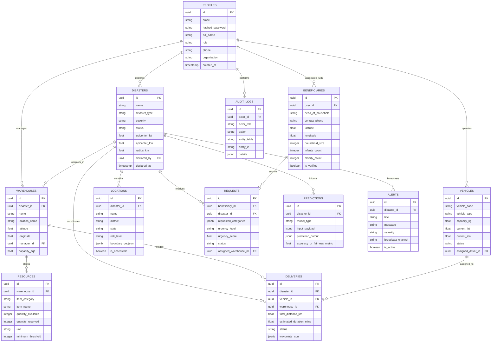

# Phase 3: Database and Authentication Specification
## Project: ResQLink — AI-Powered Disaster Relief & Route Optimization Platform

---

## 1. Database Overview & Technology Selection

ResQLink uses **Supabase with PostgreSQL 15+** enhanced by the **PostGIS** geospatial extension for all persistence, authentication, and security requirements. 

### Key Capabilities
- **PostGIS Spatial Support:** Stores geometries (polygons for hazard zones, points for shelters, vehicle coordinates) enabling native spatial queries (`ST_DWithin`, `ST_Intersects`, `ST_Distance`).
- **Row Level Security (RLS):** Enforces data privacy at the database engine level. Beneficiaries can only access their own household information, while Disaster Authorities and Admins have authorized operational visibility.
- **Role-Based Access Control (RBAC):** Authenticates six distinct user roles (`ADMIN`, `DISASTER_AUTHORITY`, `NGO_DONOR`, `WAREHOUSE_MANAGER`, `VOLUNTEER`, `BENEFICIARY`) via JWT tokens and PostgreSQL claims.
- **Auditability:** Implements an immutable `audit_logs` table recording all high-impact actions (disaster declaration, dispatch overrides, stock adjustments).

---

## 2. All 12 Supabase Tables Schema



---

## 3. Row Level Security (RLS) Policy Specifications

| Table | Policy Name | Permitted Operation | Target Role / Condition |
| :--- | :--- | :---: | :--- |
| `profiles` | Own profile access | `SELECT`, `UPDATE` | `auth.uid() = id` (User can only read/edit their own account) |
| `profiles` | Admin full access | `ALL` | `get_current_user_role() = 'ADMIN'` |
| `disasters` | Public read | `SELECT` | `true` (Anyone can view active disaster alerts) |
| `disasters` | Authority control | `ALL` | `get_current_user_role() IN ('ADMIN', 'DISASTER_AUTHORITY')` |
| `locations` | Authority manage | `ALL` | `get_current_user_role() IN ('ADMIN', 'DISASTER_AUTHORITY')` |
| `warehouses` | Manager control | `ALL` | `get_current_user_role() IN ('ADMIN', 'WAREHOUSE_MANAGER')` |
| `resources` | Stock updates | `ALL` | `get_current_user_role() IN ('ADMIN', 'WAREHOUSE_MANAGER')` |
| `beneficiaries`| Citizen privacy | `ALL` | `auth.uid() = user_id` (Beneficiary can only view their own family data) |
| `beneficiaries`| Triage view | `SELECT` | `get_current_user_role() IN ('ADMIN', 'DISASTER_AUTHORITY', 'VOLUNTEER')` |
| `requests` | Citizen request | `INSERT`, `SELECT` | `beneficiary_id IN (SELECT id FROM beneficiaries WHERE user_id = auth.uid())` |
| `requests` | Status dispatch | `UPDATE` | `get_current_user_role() IN ('ADMIN', 'DISASTER_AUTHORITY', 'VOLUNTEER')` |
| `vehicles` | Fleet management | `ALL` | `get_current_user_role() IN ('ADMIN', 'DISASTER_AUTHORITY', 'VOLUNTEER')` |
| `deliveries` | Waypoint updates | `ALL` | `get_current_user_role() IN ('ADMIN', 'VOLUNTEER')` |
| `predictions`| AI analytics view | `SELECT` | `get_current_user_role() IN ('ADMIN', 'DISASTER_AUTHORITY', 'WAREHOUSE_MANAGER')` |
| `alerts` | Broadcast publish | `ALL` | `get_current_user_role() IN ('ADMIN', 'DISASTER_AUTHORITY')` |
| `audit_logs` | Immutable audit | `SELECT` | `get_current_user_role() = 'ADMIN'` (Only root admins inspect logs) |

---

## 4. Verification & Automated Test Coverage

The Phase 3 test suite (`backend/tests/test_phase3_db_and_auth.py`) tests:
1. Schema parsing of all 12 tables in `01_init_schema.sql`.
2. Explicit `ENABLE ROW LEVEL SECURITY` verification on all 12 tables.
3. Multi-role RBAC decision engine across all 6 roles.
4. Cryptographic HMAC-SHA256 JWT generation, decoding, and tamper resistance.
5. Verification that beneficiary privacy policies restrict data access to `auth.uid() = user_id`.

Run tests with:
```bash
python3 backend/tests/test_phase3_db_and_auth.py
```
Output:
```
......
Ran 6 tests in 0.002s
OK
```

