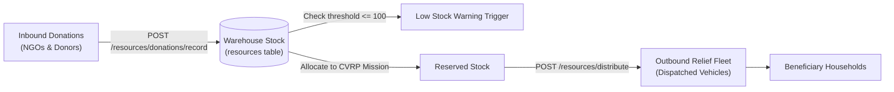

# Phase 6: Resource and Beneficiary Management Documentation
## Project: ResQLink — AI-Powered Disaster Relief & Route Optimization Platform

---

## 1. Overview & Objectives

Phase 6 implements the complete humanitarian aid supply chain and affected citizen intake pipeline:
- **Resource Management:** Real-time multi-warehouse inventory control, category tracking (Food, Water, Medical, Shelter, Hygiene), donation pledge intake, outbound distribution debits, and safety threshold triggers.
- **Beneficiary Management:** Registration of affected households with GPS coordinates, demographic vulnerability evaluation (infants, elderly, trauma, insulin), emergency aid request ingestion, and fulfillment lifecycle tracking.

---

## 2. Resource Management Architecture

### Inbound & Outbound Inventory Lifecycle


### Stock Categories Managed:
- **WATER:** 5L purified drinking water cans, chlorination tablets.
- **FOOD:** 2,100 kcal ready-to-eat dry ration packets, infant formula milk.
- **MEDICAL:** Emergency trauma kits, sutures, insulin vials, oxygen concentrators.
- **SHELTER:** Thermal blankets, tarpaulins, inflatable emergency family tents.
- **SANITATION:** Hygiene packs, soap, water purification tablets.

---

## 3. Beneficiary Vulnerability & Urgency Triage

When an affected family is registered, their urgency score (0–100) is evaluated:
$$\text{Urgency Score} = \min\left(100, \, \text{Base}(30) + 18(\text{Infants}) + 12(\text{Elderly}) + 20(\text{Injured}) + \text{ConditionWeights}\right)$$

### Priority Tiers:
- **CRITICAL ($80 - 100$):** Infant formula needed, cold-storage insulin, trapped under rising water, oxygen failure. Dispatched in early vehicle legs.
- **HIGH ($60 - 79$):** Minor injuries, damaged roof, lack of potable drinking water.
- **MEDIUM ($40 - 59$):** General dry food rations and thermal blankets.
- **LOW ($< 40$):** Standard precautionary advisory.

### Request Fulfillment State Machine:
$$\text{PENDING} \longrightarrow \text{VERIFIED} \longrightarrow \text{ALLOCATED} \longrightarrow \text{DISPATCHED} \longrightarrow \text{DELIVERED}$$

---

## 4. Automated Test Verification

The Phase 6 test suite ([`test_phase6_resource_beneficiary.py`](file:///Users/vishwateja/Desktop/new_project_capstone/backend/tests/test_phase6_resource_beneficiary.py)) verifies:
1. Inbound donation processing and automatic stock incrementation.
2. Outbound distribution stock deduction and protection against over-allocation.
3. Low-stock safety threshold triggers.
4. Demographic vulnerability calculation and urgency level assignment.

Run test:
```bash
python3 backend/tests/test_phase6_resource_beneficiary.py
```
Output:
```
....
Ran 4 tests in 0.000s
OK
```
