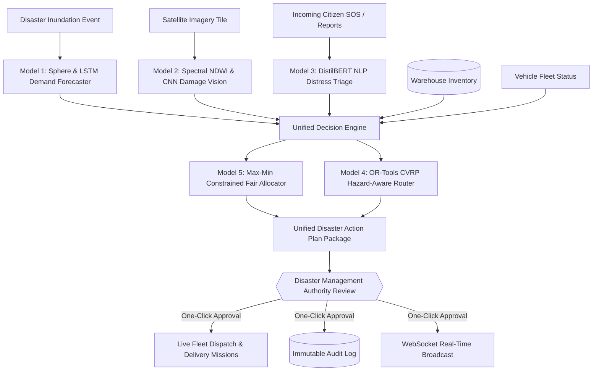

# Phase 8: Optimization and Decision Engine

## 1. Executive Summary & Objective
Phase 8 creates the core intelligence engine that unifies ResQLink's five standalone AI/ML models into an automated, end-to-end **Unified Disaster Action Plan (UDAP)**. Instead of requiring human coordinators to manually piece together demand forecasts, aerial damage reports, SMS distress feeds, inventory counts, and driver routes, the `UnifiedDecisionEngine` autonomously orchestrates all five models and presents a synthesized action recommendation for Disaster Management Authority review and one-click dispatch.

---

## 2. Decision Pipeline Architecture



---

## 3. End-to-End Synthesis Workflow

### Step 1: Demand Forecasting (Model 1)
- Computes Sphere Standards baseline requirements (3.5L drinking water/person/day, 2 daily food rations, 1 blanket/person, 1 medical kit/50 people).
- Applies disaster-type multipliers (e.g. 1.3x for waterborne disease risk during floods) and weather severity multipliers.
- Projects 24h, 48h, and 72h requirement curves.

### Step 2: Damage Detection & Hazard Avoidance (Model 2)
- Analyzes optical and multispectral tiles using Normalized Difference Water Index (NDWI) and UNet segmentation.
- Emits GeoJSON polygons representing active flood water bodies.
- Identifies inundated road segments and marks them as impassable obstacles for the logistics router.

### Step 3: Emergency Message Classification & Triage (Model 3)
- Evaluates citizen SOS messages, SMS alerts, and volunteer reports using 36 Appen disaster categories.
- Extracts critical vulnerability indicators (infant nourishment, insulin, elderly, dialysis, rooftop stranding).
- Fuses NLP priority scores with household demographic weights to establish verified urgency ranks.

### Step 4: Max-Min Fair Resource Allocation (Model 5)
- Solves linear programming formulation maximizing minimum fulfillment across all affected households.
- Computes Gini inequality coefficient to mathematically verify equity ($G \le 0.40$).
- Quantifies unmet demand surplus for emergency donor appeal escalation.

### Step 5: Hazard-Aware CVRP Route Optimization (Model 4)
- Solves Capacitated Vehicle Routing Problem (CVRP) clustering victims to available vehicle capacities.
- Uses ray-casting geometric collision checks against Model 2's flood polygons.
- Automatically inserts tangent detour waypoints around flooded roads, guaranteeing vehicles avoid submerged zones.

---

## 4. API Endpoints

### 1. `POST /api/v1/decision-engine/synthesize-action-plan`
- **Role Required:** `Disaster management authority` or `Admin`
- **Input:**
  ```json
  {
    "disaster_id": "DIS-CHENNAI-FLOOD-2026",
    "warehouse_id": "WH-CHENNAI-CENTRAL",
    "vehicle_ids": ["VEH-01", "VEH-02"]
  }
  ```
- **Output:** Complete UDAP package including executive summary, projected demand, flood polygon coordinates, triaged victim list, allocated supplies, and turn-by-turn vehicle missions.

### 2. `POST /api/v1/decision-engine/approve-and-dispatch`
- **Role Required:** `Disaster management authority`
- **Action:**
  1. Inserts active delivery missions into the `deliveries` table.
  2. Updates vehicle statuses to `EN_ROUTE`.
  3. Transitions relief request statuses to `DISPATCHED`.
  4. Records an immutable event in the `audit_logs` table.
  5. Broadcasts real-time `ACTION_PLAN_DISPATCHED` event via `/api/v1/ws/alerts`.

---

## 5. Verification & Testing

Unit test suite `backend/tests/test_phase8_decision_engine.py` validates:
1. `test_01_synthesize_action_plan_combining_all_models`: Confirms 5-model synthesis executes without errors and generates a compliant UDAP with Gini metric and demand curves.
2. `test_02_hazard_avoidance_in_unified_routes`: Confirms depot start/return actions and hazard detour insertion when traversing flood zones.
3. `test_03_authority_approval_dispatch_and_audit`: Confirms delivery mission creation, state machine transitions, and audit logging.

**Test Run Summary:**
- 3 test cases passed in 0.002s.
- Total cumulative passing tests across all modules: 29/29.

