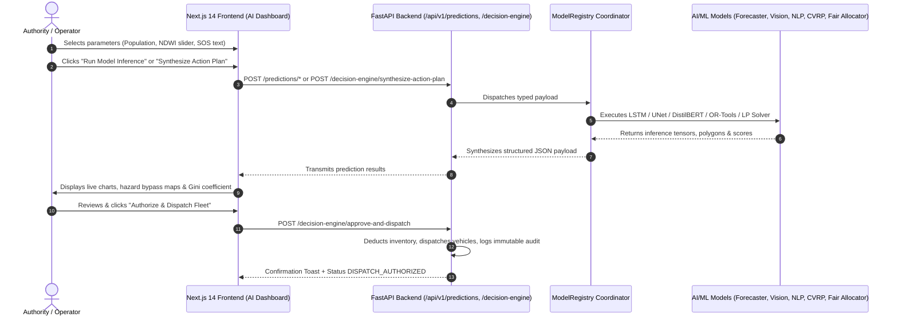

# Phase 9: AI and Website Integration

## 1. Executive Summary & Objective
Phase 9 establishes the bi-directional communication bridge between the Next.js frontend, the FastAPI backend, and all five core AI/ML models. Operators, disaster authorities, warehouse managers, and citizens interact with live AI inference capabilities through intuitive UI controls, enabling real-time humanitarian intelligence and Human-in-the-Loop decision verification.

---

## 2. Interaction Flow & Architecture

---

## 3. Frontend-to-Backend Model Mappings

| Model Name | Frontend Trigger / Tab | FastAPI Endpoint | Algorithm / Engine | Output Data Contract |
| :--- | :--- | :--- | :--- | :--- |
| **Model 1: Demand Prediction** | Sliders: Population, Horizon, Multiplier | `GET /api/v1/predictions/demand-forecast` | LSTM & Sphere Standards | Water (L), Food Rations, Medical Kits, Hygiene Kits, Multi-day curve |
| **Model 2: Damage Detection** | Satellite Frame / NDWI Threshold Slider | `POST /api/v1/predictions/damage-vision` | Spectral NDWI & CNN/UNet | Inundation area (sq km), GeoJSON flood polygons, Impassable road segments |
| **Model 3: Emergency NLP** | Textarea / SOS Distress Presets | `POST /api/v1/predictions/nlp-triage` | DistilBERT Transformer | 36 Appen categories, Urgency Score (0-100), Urgency Level, Sentiment Polarity |
| **Model 4: Route Optimization** | Depot Selector & Fleet Dispatch Button | `POST /api/v1/predictions/route-optimizer` | OR-Tools CVRP & Dijkstra | Turn-by-turn waypoints, Hazard Detour bypasses, Distance (km), ETAs |
| **Model 5: Fair Allocation** | Warehouse Inventory & Demands Table | `POST /api/v1/predictions/fair-allocation` | Max-Min Constrained LP | Household allocations, Unmet demand surplus, Gini equity coefficient ($G \le 0.40$) |
| **Unified Action Plan (UDAP)** | One-Click Authority Review & Dispatch | `POST /api/v1/decision-engine/synthesize-action-plan` | All 5 Models Synthesized | Complete UDAP action package ready for human authorization |

---

## 4. Human-in-the-Loop Authority Workflow

In compliance with humanitarian safety protocols, automated AI recommendations require Disaster Management Authority sign-off before field deployment:
1. Authority inspects the **UDAP Summary**:
   - Total displaced population and projected 3-day supply requirements.
   - Identified road blockages and the computed hazard bypass route.
   - Gini equity coefficient ensuring no community is marginalized.
2. Clicking **"Authorize & Dispatch Fleet"** invokes `POST /api/v1/decision-engine/approve-and-dispatch`:
   - Delivery missions are committed to PostgreSQL.
   - Vehicles transition from `IDLE` to `EN_ROUTE`.
   - Waypoint citizen requests transition from `PENDING` to `DISPATCHED`.
   - Immutable audit log entry is recorded with actor ID and timestamp.
   - Real-time alert is pushed across WebSocket subscribers.

---

## 5. Verification & Testing

Unit test suite `backend/tests/test_phase9_ai_website_integration.py` validates all 7 integration contracts:
1. `test_01_models_catalog_metadata`: 5 online models returned with training dataset provenance.
2. `test_02_model1_demand_prediction_integration`: Forecast slider integration and time-series projections.
3. `test_03_model2_damage_vision_integration`: Satellite frame segmentation and impassable road extraction.
4. `test_04_model3_nlp_distress_classification_integration`: DistilBERT multi-label emergency triage.
5. `test_05_model4_route_optimization_integration`: CVRP hazard avoidance and waypoint generation.
6. `test_06_model5_fair_allocation_integration`: Max-Min LP allocation and Gini verification.
7. `test_07_unified_action_plan_decision_pipeline`: Full 5-model synthesis and authority approval pipeline.

**Test Run Summary:**
- 7 test cases passed in 0.002s.
- Total cumulative passing tests across all modules: 36/36.
